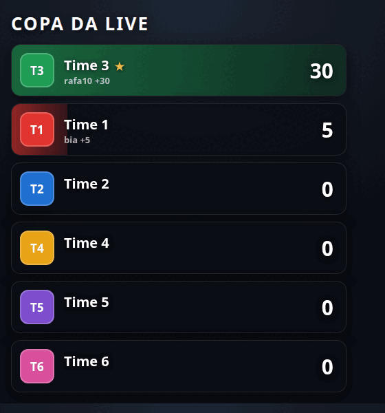

# Placar da Live

Placar de disputa entre times para transmissão ao vivo no TikTok. Os
espectadores escolhem um time e mandam presentes; o presente vira ponto e o
placar sobe na tela, ao vivo.

Roda como **fonte de navegador** dentro do TikTok LIVE Studio (ou OBS) e recebe
os eventos de presente do **TikFinity**, que já está conectado à sua LIVE.

- Sem instalação, sem servidor, sem mensalidade: são 4 arquivos numa pasta.
- Sem conta em site nenhum. Nada sai da sua máquina.
- O placar **não zera** se a fonte recarregar no meio da transmissão.



---

## Como funciona

```
TikTok LIVE  →  TikFinity  →  ws://localhost:21213  →  este overlay
```

O TikFinity já recebe os eventos da sua live e disponibiliza cada presente numa
porta local da sua própria máquina. O overlay escuta essa porta, descobre de
quem é o presente, para qual time vai, quantos pontos vale, e atualiza a tela.

---

## Instalação

1. Baixe a pasta e coloque em um lugar fixo do computador, por exemplo
   `C:\placar-live`. Se ela mudar de lugar depois, a fonte no LIVE Studio
   precisa ser refeita.

2. No **TikFinity**, abra as configurações e ligue a opção de **WebSocket /
   API local** (a que expõe os eventos na porta `21213`). Sem isso o overlay
   não recebe nada.

3. No **TikTok LIVE Studio**, adicione uma fonte:

   - Tipo: **Navegador** (Browser Source)
   - Marque **Arquivo local** e aponte para o `index.html` da pasta
   - Largura: **560**  ·  Altura: **620**
   - Marque **Desligar a fonte quando não estiver visível**: **NÃO**
     (se marcar, o placar zera toda vez que você troca de cena)

4. Posicione o placar na tela e comece a live.

O fundo é transparente de propósito: o placar flutua sobre a imagem.

---

## Ajustando o placar — arquivo `config.js`

Abra `config.js` em qualquer editor de texto (Bloco de Notas serve). É o único
arquivo que você mexe. Cada item está explicado dentro dele.

### Trocar os times

```js
teams: [
  { id: 1, name: "Flamengo",  color: "#e2342f", initials: "FLA", badge: "" },
  { id: 2, name: "Palmeiras", color: "#1f9d55", initials: "PAL", badge: "" },
  ...
]
```

Para usar escudo de imagem, coloque o arquivo dentro da pasta `times/` e
escreva o caminho: `badge: "times/flamengo.png"`. Imagem quadrada, 128×128.

### Trocar os pontos de cada presente

```js
gifts: {
  "rose":      { points: 5,  team: 0, effect: "pulse" },
  "ice cream": { points: 10, team: 0, effect: "pulse" },
  "galaxy":    { points: 50, team: 0, effect: "flash" },
}
```

Mudou de ideia no meio da temporada? Troque o número, salve, e clique com o
botão direito na fonte do LIVE Studio → **Atualizar**. Leva 5 segundos e o
placar acumulado continua de onde estava.

Presente que não está nessa lista **não fica de fora**: por padrão ele vale a
própria quantidade de moedas em pontos (`unknownGift: "diamond"`). Assim
presente novo que a TikTok lançar já entra na disputa sozinho.

### Como o espectador escolhe o time

Item `mode` do `config.js`:

| Modo | Como funciona |
|---|---|
| `"chat"` | O espectador digita `3` (ou `time 3`, ou o nome do time) no chat e depois manda qualquer presente. Os pontos vão pro time dele, e continuam indo até ele escolher outro. |
| `"gift"` | Cada presente pertence a um time fixo. Rosa é do Time 1, Sorvete é do Time 2. Preencha o campo `team` de cada presente. Ninguém precisa digitar nada. |
| `"both"` | Presente com dono vale pelo dono; presente sem dono vai pro time que a pessoa escolheu no chat. |

O padrão é `"chat"`, que é o que mais engaja: obriga o espectador a se declarar
antes de gastar.

### Zerar o placar

Três formas:

- você digita `!zerar` no chat da própria live (precisa ter seu @ na lista
  `owners` do `config.js`);
- abre a fonte com `index.html?reset=1` uma vez;
- painel de demonstração, botão **zerar**.

---

## Testar sem estar ao vivo

Abra `index.html?demo=1&fundo=1` no navegador. Ele simula presentes
aleatórios chegando, com fundo escuro em vez de transparente. Serve para
conferir cores, nomes e tamanho antes de entrar ao ar. É também como o vídeo de
demonstração foi gravado.

Chaves que podem ser somadas na URL, separadas por `&`:

| Chave | Efeito |
|---|---|
| `demo=1` | simula presentes chegando |
| `fundo=1` | desenha um fundo escuro no lugar da transparência |
| `limpo=1` | esconde os botões de demonstração, para gravar vídeo |
| `seed=7` | repete sempre a mesma sequência de presentes |
| `flip=0` | troca o deslizar dos times por uma troca seca de posição |
| `reset=1` | começa do zero, ignorando o placar salvo |

Para disparar um evento específico, abra o console do navegador (F12):

```js
placar.add(3, 50)   // soma 50 pontos no time 3
placar.reset()      // zera
placar.scores()     // mostra o placar atual
```

---

## Detalhes que evitam problema em live

**Combo de presente não conta em dobro.** Quando alguém segura o botão e manda
o mesmo presente 20 vezes, a TikTok emite um evento por unidade. Somar todos
multiplica o placar. O overlay ignora os eventos intermediários e conta só o
fechamento da sequência, pelo `repeatCount` — o total sai certo.

**Evento repetido não conta duas vezes.** Cada evento é identificado pelo
`msgId` e os últimos 400 ficam registrados. Reconexão do TikFinity não
duplica ponto.

**Queda do TikFinity não derruba o placar.** O overlay reconecta sozinho, com
espera crescente até 10 segundos, e mostra um aviso vermelho discreto no canto
enquanto está fora. O placar continua na tela com os pontos que já tinha.

**Recarregar a fonte não zera.** O placar é gravado no navegador a cada ponto.
Só zera por comando seu, ou se você mudar a lista de times no `config.js` — aí
a disputa é outra e começar do zero é o certo.

---

## Estrutura

| Arquivo | O que é |
|---|---|
| `config.js` | **Único arquivo que você edita.** Times, presentes, pontos, modo |
| `index.html` | A página que entra como fonte no LIVE Studio |
| `estilo.css` | Aparência: cores, tamanhos, animações |
| `overlay.js` | Motor: conexão, regras de pontuação, desenho da tela |
| `times/` | Onde ficam as imagens de escudo, se você usar |

---

## Problemas comuns

| Sintoma | Causa provável |
|---|---|
| Aviso vermelho "TikFinity fora do ar" | TikFinity fechado, ou a API local desligada nas configurações dele |
| Placar aparece mas nunca sobe | Modo `"chat"` e ninguém escolheu time ainda. Peça no ar: "digita o número do seu time no chat" |
| Um presente específico não pontua | Nome diferente do que está no `config.js`. Confira no painel de eventos do TikFinity o nome exato |
| Placar zerou sozinho | Alguma mudança na lista `teams` do `config.js`, ou `resetOnLoad: true` |
| Fundo branco na live | A fonte foi adicionada como imagem/janela em vez de **Navegador** |

---

Feito por [Leandro Baldan](https://leandrobaldan.vercel.app) — automação e
integração de dados.
